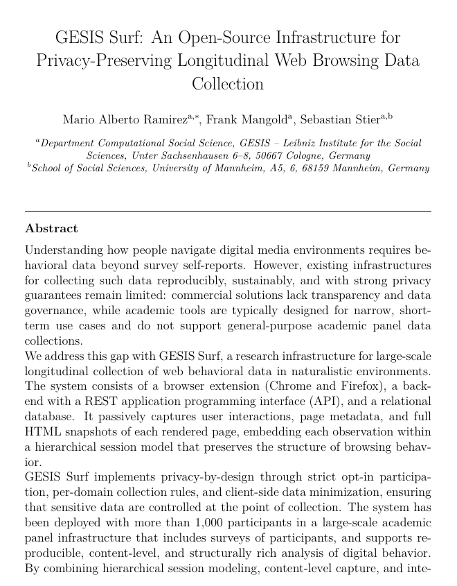

<div align="center">
<table><tr><td bgcolor="white" style="padding: 20px;">

</td></tr></table>

# GESIS Surf — The Paper

**An Open-Source Infrastructure for Privacy-Preserving Longitudinal Web Browsing Data Collection**

[](GESIS_Surf_preprint.pdf)
[](https://www.sciencedirect.com/journal/softwarex)
[](https://tug.org/texlive/)
[](.devcontainer/devcontainer.json)
[](LICENSE)

[Paper](#-paper) •
[Software](#-software) •
[Build the PDF](#-build-the-pdf) •
[Citation](#-citation) •
[License](#-license)

</div>

---

## 📄 Paper

<div align="center">
<a href="GESIS_Surf_preprint.pdf">

</a>

**[📥 Read the full paper (PDF, 18 pages)](GESIS_Surf_preprint.pdf)**
</div>

**Authors:** Mario Alberto Ramirez, Frank Mangold, Sebastian Stier
<br>GESIS – Leibniz Institute for the Social Sciences · University of Mannheim

**Status:** 📬 submitted to *SoftwareX* (October 2026) · 📝 arXiv preprint link coming soon

This repository contains the LaTeX source of the paper, ready to build in three different ways.

## 🧩 Software

> 🔗 **Looking for GESIS Surf itself?** The software lives in two repositories:

| Component | Repository |
| --- | --- |
| 🌐 Browser extension (Chrome and Firefox) | [gesiscss/gesis_surf_extension](https://github.com/gesiscss/gesis_surf_extension) |
| 🗄️ Backend (REST API, database, infrastructure) | [gesiscss/gesis_surf_backend](https://github.com/gesiscss/gesis_surf_backend) |

## 📁 Contents

```text
├── GESIS_Surf_preprint.pdf   # the compiled paper
├── arxiv/
│   ├── main.tex              # paper source (arXiv preprint version)
│   ├── main.bib              # references
│   ├── latexmkrc             # build settings for latexmk
│   └── figures/              # architecture diagrams
├── .devcontainer/            # Docker setup with TeX Live 2025
└── .vscode/                  # recommended extensions and settings
```

## 🔧 Build the PDF

Pick whichever suits you:

| | Option | You need |
| --- | --- | --- |
| 💻 | [Locally with VS Code](#-1-locally-with-vs-code) | TeX Live + VS Code |
| 🐳 | [In a Dev Container](#-2-in-a-dev-container) | Docker + VS Code |
| 🌍 | [On Overleaf](#-3-on-overleaf) | A web browser |

### 💻 1. Locally with VS Code

Requires TeX Live (2023 or newer) and VS Code.

1. 📂 Open this folder in VS Code and install the recommended extension **LaTeX Workshop** when prompted.
2. 💾 Open `arxiv/main.tex` and save it. The PDF builds automatically and opens in a tab.

Prefer the terminal?

```bash
cd arxiv
latexmk main.tex
```

### 🐳 2. In a Dev Container

No TeX installation needed. Requires Docker and VS Code with the **Dev Containers** extension.

1. 📂 Open this folder in VS Code.
2. 🔄 Choose **Reopen in Container** when prompted
   (or run *Dev Containers: Reopen in Container* from the command palette).
   The first start downloads the TeX Live 2025 image (about 2.6 GB).
3. 💾 Open `arxiv/main.tex` and save it to build the PDF.

### 🌍 3. On Overleaf

1. 🗜️ Zip the **contents** of the `arxiv/` folder (`main.tex`, `main.bib`, `latexmkrc`, `figures/`).
2. ⬆️ In Overleaf, choose **New Project → Upload Project** and select the zip file.

## 📚 Citation

Until the article is published, please cite the preprint. GitHub shows the citation under
**Cite this repository** (from [`CITATION.cff`](CITATION.cff)).

## 📜 License

The paper text, figures, and LaTeX source are licensed under
[CC BY 4.0](https://creativecommons.org/licenses/by/4.0/) (see [`LICENSE`](LICENSE)).
The GESIS Surf software (extension and backend) is licensed separately under the MIT License
in its own repositories.

---

<div align="center">
Developed at <a href="https://www.gesis.org/en/home">GESIS – Leibniz Institute for the Social Sciences</a>
</div>
